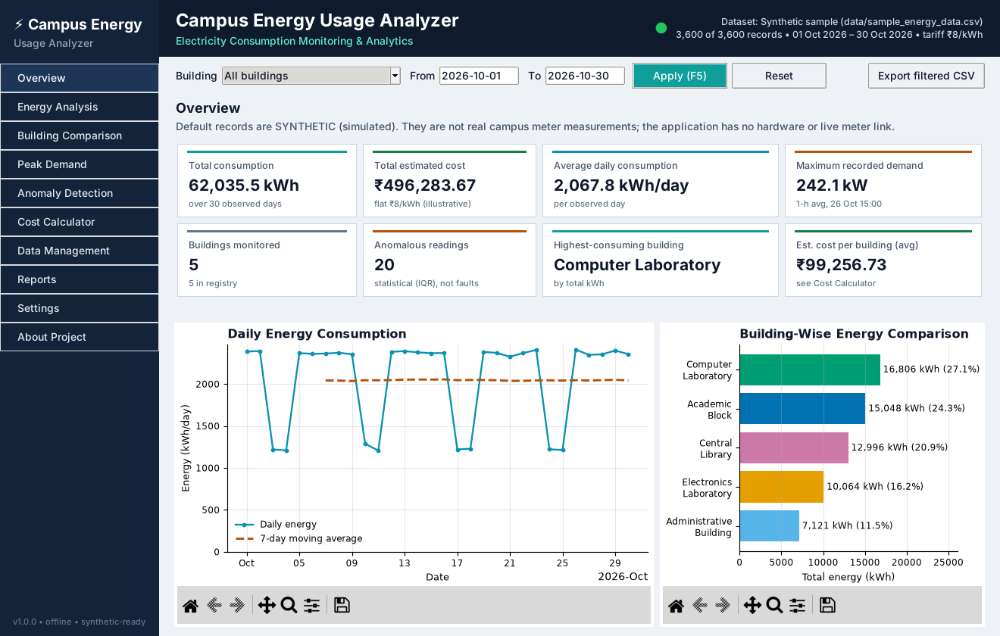
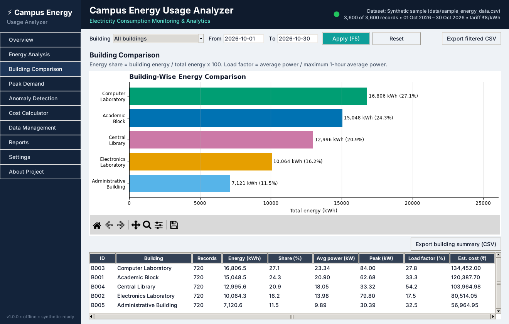
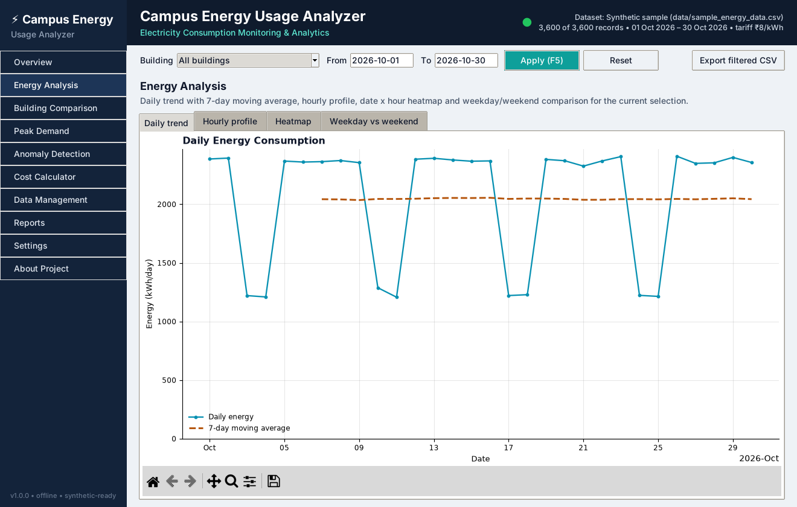
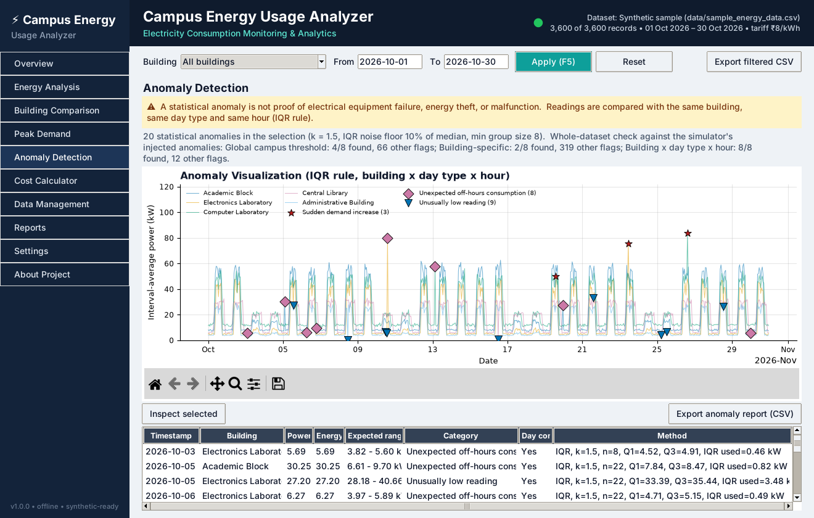
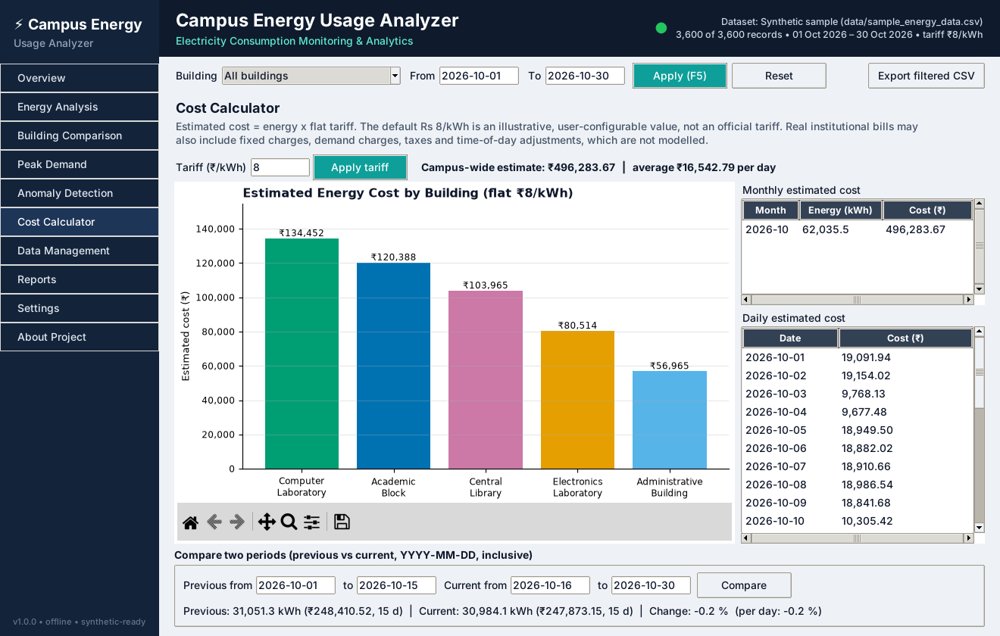
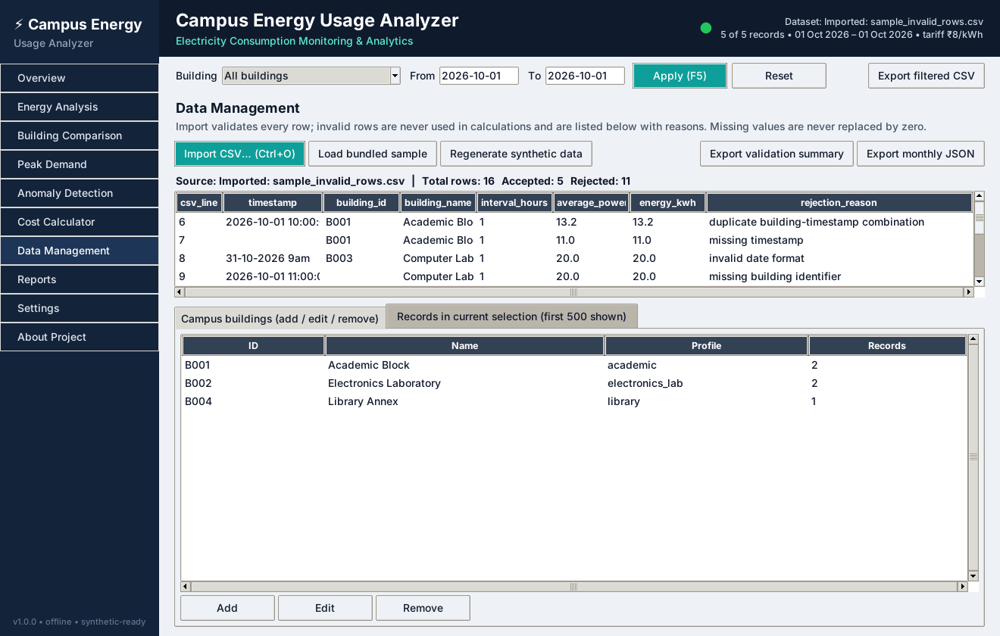
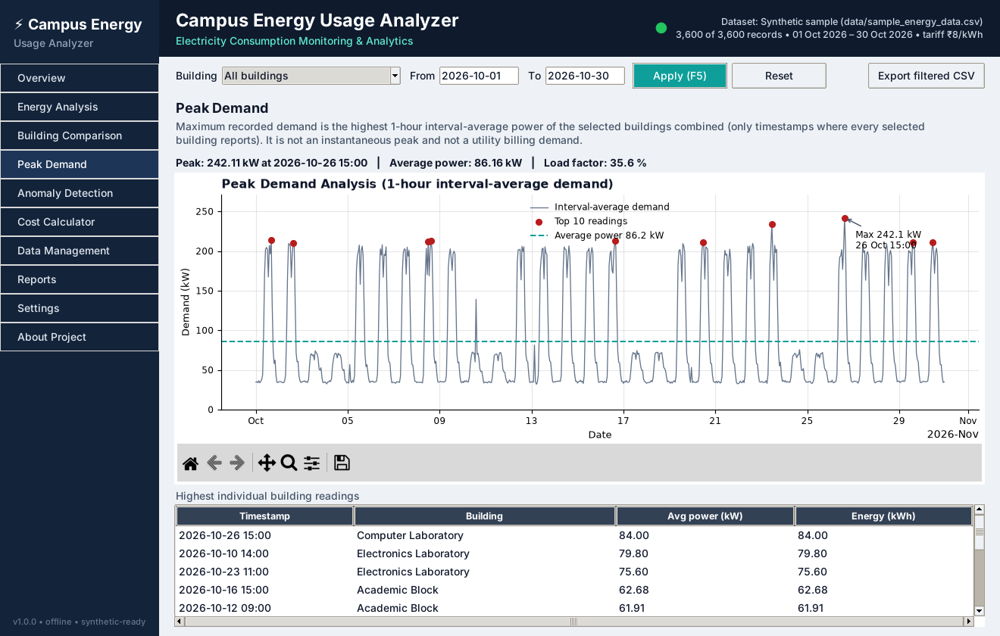
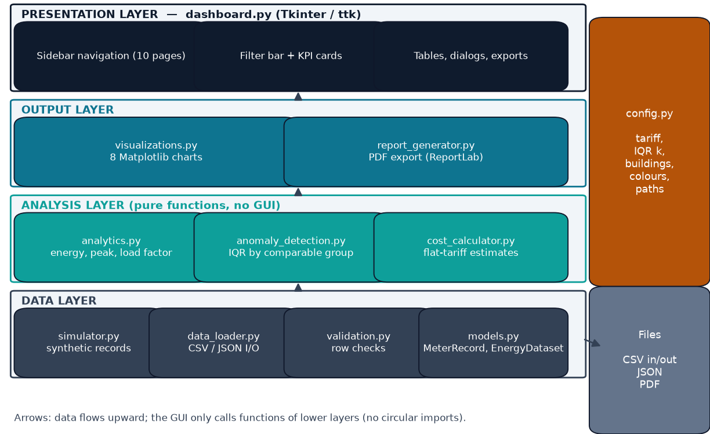
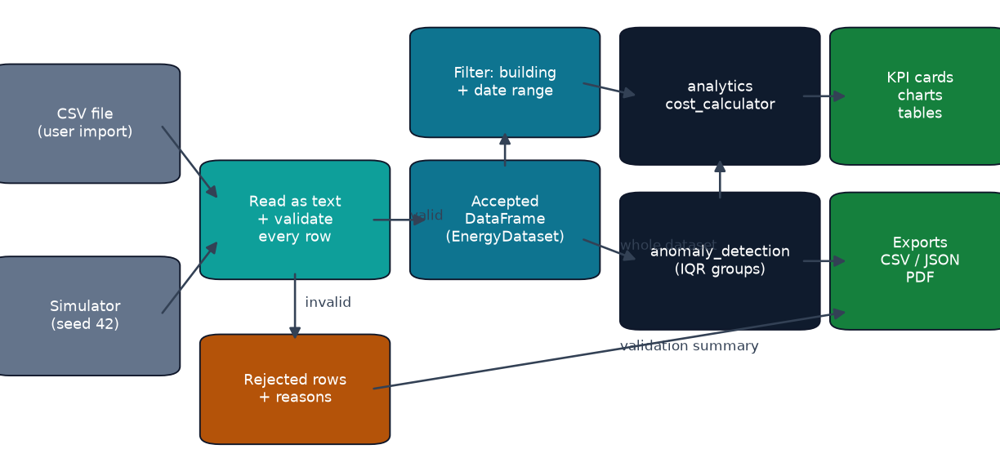

# Campus Energy Usage Analyzer

**Electricity Consumption Monitoring and Analytics System** — an offline Python desktop application (Tkinter + Pandas + NumPy + Matplotlib) that validates, analyses and visualises hourly electricity-consumption records of campus buildings.

> **Honest scope:** this is a 100 % software project. It does **not** connect to real electricity meters. The bundled dataset is **synthetic** (simulated with a fixed random seed) and every generated row is labelled `data_source = synthetic`. You can also import your own CSV files.



## Overview

Campus buildings (classrooms, laboratories, library, offices) use electricity in very different patterns. In a spreadsheet it is hard to see which building uses most energy, when the campus peak occurs, what the energy is likely to cost, or which readings are unusual. This application turns interval meter data into validated KPIs, eight charts, statistical anomaly flags and exportable reports.

## Features (all implemented and tested)

- **Dashboard** with 8 KPI cards: total kWh, estimated cost (₹), average kWh/day, maximum 1-hour demand (kW), buildings, anomalous readings, highest-consuming building, average cost per building. Shows "—" instead of invented values when no data matches.
- **Filters**: building selector and inclusive date range; every page, KPI and chart refreshes on change (F5).
- **Building management**: 5 default buildings; add, edit (name/profile) and remove (with confirmation explaining what happens to records).
- **Synthetic data simulator**: realistic per-building load profiles, weekends, lunch dip, Gaussian noise (never negative), 8 labelled injected anomalies, fixed seed → 3,600 reproducible records.
- **Validation** of 11 rule types (missing/invalid timestamps, negative values, NaN/inf, invalid intervals, energy ≠ power × time, duplicate building-timestamp, missing IDs, ID/name conflicts, missing columns). Rejected rows keep their original values, line number and reason; summary exportable.
- **Analytics**: total and daily energy, campus demand, average power, peak demand, load factor, building shares, % change between periods, hourly profile, heatmap, weekday vs weekend, 7-day moving average (NumPy), data completeness.
- **Anomaly detection**: IQR rule with **building × day type × hour** comparison groups, documented fallback for small groups, expected range, category and method for every flag, and a built-in evaluation against a global threshold.
- **Cost calculator**: configurable flat tariff, campus/building/daily/monthly estimates, two-period comparison.
- **8 embedded Matplotlib charts** with zoom/pan/save toolbar.
- **Exports**: filtered records CSV, building summary CSV, anomaly report CSV, validation summary CSV, monthly summary JSON, PDF analysis report.
- **73 automated tests** (pytest) including 10 GUI tests that drive the real Tkinter window.

## Screenshots

All screenshots were captured from the running application (`scripts/capture_screenshots.py`).

| Building comparison | Energy analysis |
|---|---|
|  |  |
| **Anomaly detection** | **Cost calculator** |
|  |  |
| **Data management (faulty CSV imported)** | **Peak demand** |
|  |  |

## Technology Stack

| Technology | Use |
|---|---|
| Python 3.10+ (developed/tested on 3.12) | Core language, dataclasses, pathlib, logging |
| Tkinter / ttk | Desktop GUI |
| Pandas ≥ 2.2 | Data processing, validation, aggregation |
| NumPy ≥ 1.26 | Quartiles, moving average, simulation |
| Matplotlib ≥ 3.8 | Charts embedded in Tkinter |
| ReportLab ≥ 4.0 | PDF report export |
| pytest, pytest-cov | Automated tests and coverage |

## Installation (Windows 10/11, PowerShell)

```powershell
git clone https://github.com/CypherCodeNinjaX/campus-energy-usage-analyzer.git
cd campus-energy-usage-analyzer
py -m venv .venv
.\.venv\Scripts\Activate.ps1
python -m pip install -r requirements.txt
```

**If PowerShell blocks `Activate.ps1`** (execution policy), skip activation and call the venv's Python directly — no policy change needed:

```powershell
py -m venv .venv
.\.venv\Scripts\python.exe -m pip install -r requirements.txt
.\.venv\Scripts\python.exe -m campus_energy.main
```

`requirements.txt` also installs this project in editable mode (`-e .`), which is what makes `python -m campus_energy.main` work.

## Run Application

```powershell
python -m campus_energy.main
```

(or simply `campus-energy` after installation). Shortcuts: `Ctrl+1…9`, `Ctrl+0` switch pages, `F5` refresh, `Ctrl+O` import CSV, `Ctrl+E` export filtered CSV.

## Testing

```powershell
python -m pytest
python -m pytest --cov=campus_energy      # with coverage
```

Latest local run (Python 3.12, Linux with a virtual display): **73 passed, 0 failed, 0 skipped; 86 % statement coverage** — see `docs/test_report.txt` and `docs/test_results.xml`. GUI tests skip automatically when no display is available. GitHub Actions runs the suite on Ubuntu and Windows (`.github/workflows/tests.yml`).

## Dataset Information

- **Synthetic generation** (`simulator.py`, seed 42): `P = P_base + (P_peak − P_base) × activity`, multiplied by noise `N(1, σ)` clipped to 0.7–1.3; activity follows each building's hours, a lunch dip and a weekend factor. Default: 5 buildings × 30 days (1–30 Oct 2026) × 24 h = **3,600 records**. Regenerate: `python scripts/generate_sample_data.py`.
- **Fields:** `timestamp, building_id, building_name, interval_hours, average_power_kw, energy_kwh` (+ optional `estimated_cost_inr`, `data_source`; the sample also has `injected_anomaly` ground-truth labels).
- **Intervals:** hourly in the sample; any interval 0 < t ≤ 24 h is accepted on import.
- **Validation rules:** see [`docs/Methodology.md`](docs/Methodology.md). `data/sample_invalid_rows.csv` demonstrates every rejection rule.
- **Limitations:** simulated values describe the model, not a real campus.

## Project Architecture



```text
src/campus_energy/
  config.py            constants, default buildings, colours, portable paths
  models.py            Building, MeterRecord, BuildingRegistry, EnergyDataset (__len__/__iter__/__getitem__)
  simulator.py         deterministic synthetic data
  validation.py        row-level validation with reasons
  data_loader.py       CSV/JSON import & export
  analytics.py         energy, demand, load factor, summaries
  anomaly_detection.py IQR detection by comparable groups
  cost_calculator.py   flat-tariff estimates
  visualizations.py    8 Matplotlib chart functions
  report_generator.py  PDF analysis report
  dashboard.py         Tkinter application
  main.py              entry point
```



## Mathematical Model

| Quantity | Formula | Unit |
|---|---|---|
| Interval energy | E = P × t | kWh |
| Total energy | E_total = Σ Eᵢ | kWh |
| Average daily energy | E_total / days **with valid observations** | kWh/day |
| Average power | E_total / observed duration | kW |
| Maximum recorded demand | max of 1-hour interval-average campus demand (not instantaneous, not billing demand) | kW |
| Load factor | P_avg / P_max × 100 | % |
| Estimated cost | E × tariff (flat, illustrative ₹8/kWh default) | ₹ |
| Energy share | E_building / E_total × 100 | % |
| % change | (current − previous) / previous × 100 (n/a if previous = 0) | % |
| IQR limits | Q1 − 1.5·IQR′, Q3 + 1.5·IQR′, IQR′ = max(IQR, 0.10 × median) | kW |

Results on the bundled synthetic data: 62,035.5 kWh total, 2,067.8 kWh/day, 242.1 kW peak (26 Oct 15:00), 35.6 % load factor, ₹4,96,283.67 at ₹8/kWh, 20 statistical anomalies (all 8 injected anomalies detected).

## Project Report

[`docs/Campus_Energy_Usage_Analyzer_Report.pdf`](docs/Campus_Energy_Usage_Analyzer_Report.pdf) — 10-page A4 report with fillable cover fields. Rebuild it (re-runs the tests and recomputes every number): `python scripts/build_report.py`.

More docs: [User Guide](docs/User_Guide.md) · [Methodology](docs/Methodology.md) · [Viva Preparation](docs/Viva_Preparation.md)

## Limitations

- Offline analytical simulator: **no connection to real electricity meters**; default data are synthetic.
- Hourly averages hide short peaks; billing demand, power factor and reactive energy are not modelled.
- Costs use a flat tariff only — fixed charges, demand charges, taxes and time-of-day rates are excluded; results are **not** electricity bills.
- **A statistical anomaly is not proof of electrical equipment failure, energy theft, or malfunction.**
- Building edits/deletions change the in-memory dataset only (source CSV files are never modified).

## Future Improvements

15-minute data with true billing-demand calculation · time-of-day tariffs · weather normalisation · SQLite persistence · Modbus/MQTT meter import · rolling seasonal baselines for anomaly detection.

## License

[MIT](LICENSE)
